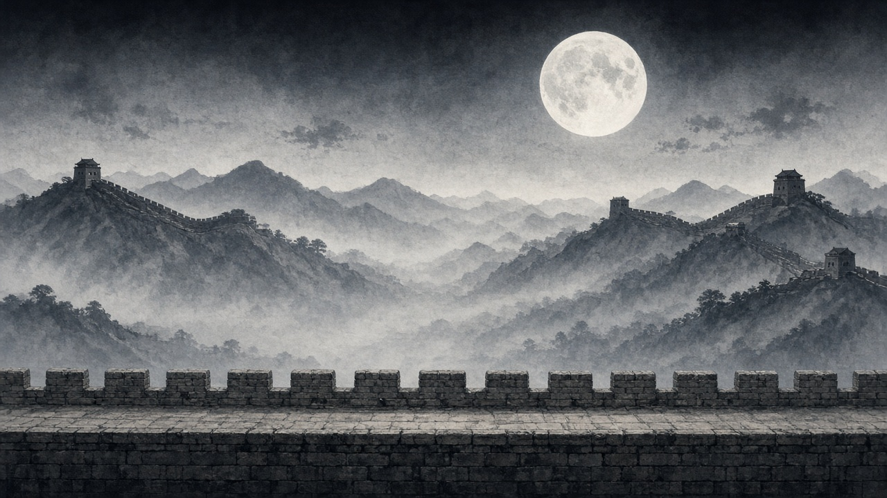
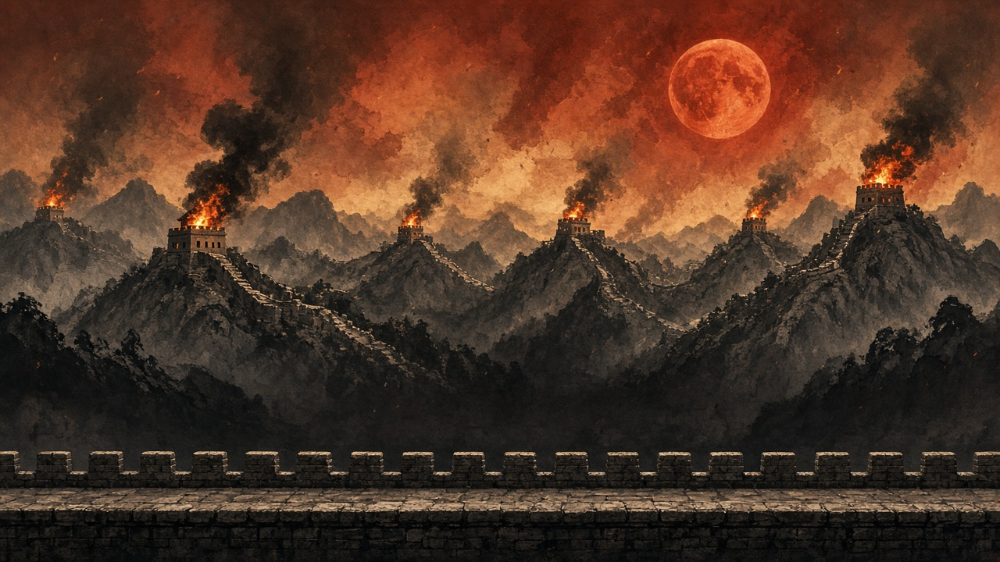
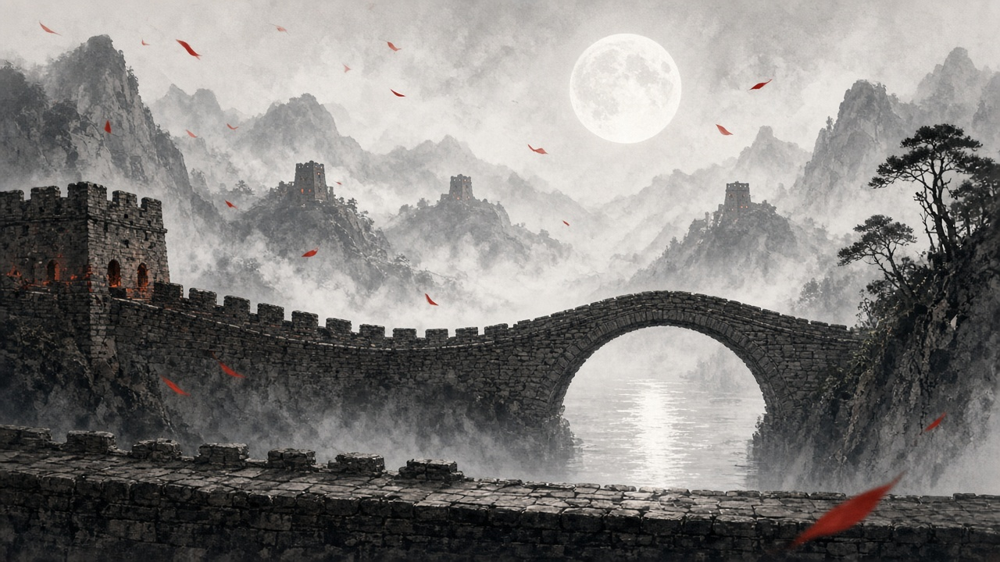
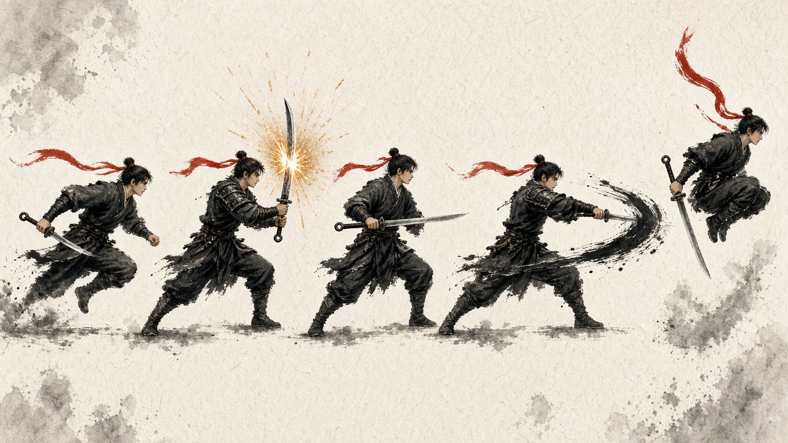
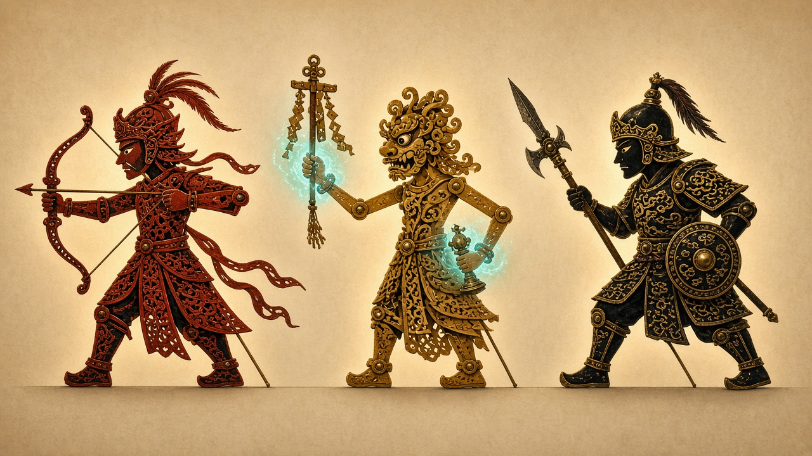
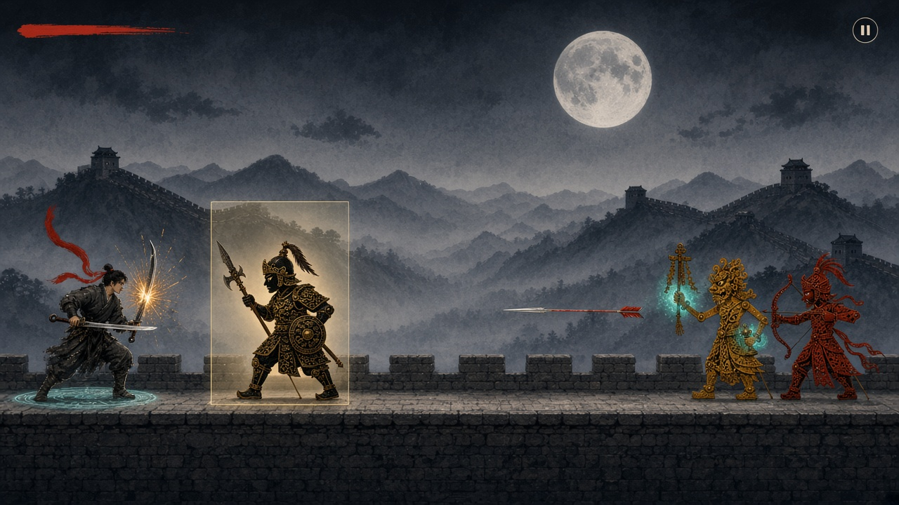
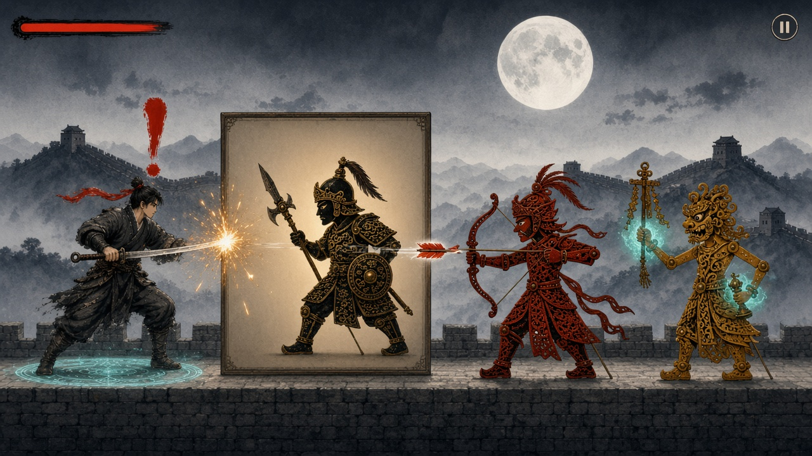

# 音魂游｜关卡美术设定（曲目：《缘分一道桥》）

**设计初稿 · 2026-10-16**

> 本文的图片都是 AI 生成的概念参考图，用来确定画风、配色和造型，**不能直接当游戏素材**：同一角色在不同图里细节不一致，背景不能无缝循环滚动，也没有透明底。正式素材需按本文规格重新绘制或整理。本文只涉及美术表现，不改变《具体功能》中的任何玩法规则。

## 1. 音乐与主题

- 《缘分一道桥》是张艺谋电影《长城》（2016）的片尾曲，王力宏作曲、方文山作词，王力宏与谭维维合唱。
- 歌曲开篇引用王昌龄《出塞》：“秦时明月汉时关，万里长征人未还”。这首歌最初是为千军万马的战场戏创作的，曲风是流行旋律加上谭维维秦腔式的喊唱，史诗感很强。
- **关卡主题：明月 · 边关 · 烽火 · 一道桥。** 玩家扮演守关少年，在长城城墙上一路奔跑，击退从皮影幕布里走出来的傀儡兵，音乐结束时走到一座石桥前。

**为什么怪物用皮影：**

1. 谭维维以《华阴老腔一声喊》出名，老腔原本就是陕西皮影戏的唱腔，皮影和这首歌的唱法同源。
2. 皮影天生是侧面造型、关节可动，正好适合横版 2D。动画可以用“拆件 + 关节旋转”来做，比逐帧手绘省很多工作量。
3. 避开电影里的饕餮怪物和“五军”配色，保持原创。

## 2. 整体画风与配色

- **人物和场景用水墨**：以墨色、灰阶为主，整体低饱和。
- **敌人用皮影**：彩色、镂空雕花、背后透光。在墨色的世界里，彩色的皮影天然最显眼，玩家一眼就能找到敌人。

功能色只用在固定用途上，场景里不要大面积使用，避免混淆：

| 用途 | 颜色 | 参考色值 |
| --- | --- | --- |
| 场景底色 | 墨灰、月白 | `#2B2B2B`、`#E8E4D8` |
| 主角识别色（发带） | 朱红 | `#C8321E` |
| 玩家成功反馈（弹反火花） | 金色 | `#F2B53A` |
| 魔法（不能招架、只能跳） | 青色 | `#3EC9C1` |
| 魔法预警感叹号 | 朱红 | `#D9381E` |

**规则：青色只给魔法用。** 玩家看到青色，就知道“这个挡不住，要跳”。

## 3. 场景：长城城墙

人物始终在城墙顶的马道上奔跑，马道就是地面。背景分层视差滚动：

| 层 | 内容 | 滚动速度 |
| --- | --- | --- |
| 远景 | 天空、月亮 | 几乎不动 |
| 中景 | 水墨山脉、长城、烽火台 | 慢 |
| 地面 | 城墙马道和垛口 | 与人物前进速度一致 |
| 前景（可选） | 飘过的烟尘、花瓣 | 比地面快 |

每层素材都需要左右无缝衔接，才能循环滚动。画面中间一带（人物和怪物所在的高度）保持低对比、少细节。

### 3.1 场景随音乐分三段

各段的具体起止秒数，要拿到实际使用的音频文件后再对齐，这里先定画面方向：

| 音乐段落 | 画面 | 战斗节奏（建议） |
| --- | --- | --- |
| 开头引诗（“秦时明月汉时关”） | 月下长城，安静 | 敌人少，用来熟悉操作 |
| 主歌 | 烽火台一座座点燃，天色渐红 | 敌人逐渐增多 |
| 副歌高潮（谭维维的喊唱） | 烽火连天，血色月亮 | 敌人最密集 |
| 尾声 | 烟消云散，前方出现石拱桥 | 敌人减少，跑上石桥时音乐结束、通关 |

尾声这张图里，桥在画面中景。实际做的时候，最后一段的地面要从城墙马道过渡成桥面，让人物真正跑上桥。

## 4. 人物：守关少年

- **造型**：汉代戍边少年，束发，墨黑短打，配皮质护肩、护腕。
- **识别色**：一条朱红长发带。奔跑时向后飘，是全身唯一的红色，在墨色画面里一眼就能找到主角，也能体现奔跑速度。
- **武器**：环首刀。这是汉代的直刀，刀柄末端有一个圆环，正好对应“汉时关”。弹反时刀身竖起，火花从刀刃上迸出。
- **尺寸**：与普通怪物等高，约为屏幕高度的 1/5～1/4，给箭矢留出足够长的飞行距离。

### 4.1 动作清单

按《具体功能》第 5 节的操作对应：

| 操作 | 动作 | 画面要点 |
| --- | --- | --- |
| 无操作 | 自然奔跑（循环） | 发带向后飘 |
| 单击 | 短促招架 / 弹反 | 刀迅速竖起再放下 |
| 按住 | 持续招架 | 刀横在身前 |
| 双击 | 近战攻击 | 向前横斩，带墨迹刀光 |
| 上划 | 跳跃 | 收腿，发带上扬 |
| 被命中（建议补充） | 受伤 | 身体后仰，墨点溅开 |

### 4.2 弹反反馈

- **普通弹反**：刀刃处迸出一小簇金色火花。
- **完美弹反**：火花更大、更多，中心加白色高光；同时以刀刃为中心扩散一圈墨环，配合极短的顿帧和音效。具体参数在原型阶段试玩调整。

## 5. 怪物：皮影傀儡兵

**共同点**：皮影材质（镂空雕花、关节铆钉、背后透光），全部面朝左，与主角等高。

- **出场**：从画面右侧显影出现。
- **被击败**：碎成皮影碎片飘落，或燃成纸灰。

| 怪物 | 对应敌人类型 | 造型 | 攻击前的预备动作 | 攻击表现 |
| --- | --- | --- | --- | --- |
| 皮影弓手 | 弓箭远程 | 朱红，翎羽头盔 | 拉满弓、停顿一下 | 黑杆红羽的箭，带白色拖尾 |
| 傩面巫师 | 魔法远程 | 赭黄，戴傩戏面具，手持铜铃和符幡 | 摇铃，双手亮起青光 | 玩家脚下出现青色符阵，2 秒后爆发 |
| 戈盾兵 | 近战 | 墨黑描金，长戈加圆盾 | 高举长戈 | 向前劈下 |

- **预备动作**：让玩家能提前看出“要攻击了”。时长要和音乐拍点一起设计。
- **魔法预警**：伤害生效前 2 秒，玩家头顶出现一个朱红的毛笔字感叹号，同时脚下的青色符阵开始发光。感叹号保留文档要求的形式，只把画风做成笔触样式。
- **戈盾兵的走路**：皮影本来就是一顿一顿地走，正好表现“速度只有玩家的 35%”带来的沉重感和压迫感。

## 6. 描边长方形：做成一块淡淡的皮影幕布

文档规定的规则全部保留：长方形，与敌人等高，比敌人略宽，显示较弱，敌人全身进入后才算进入。

画风上的处理建议如下：

- 皮影戏演出用的白色幕布叫“亮子”，把这个长方形画成一块若隐若现的幕布：一条细细的淡金色线框，内部只带极淡的暖色。
- 敌人全身进入时，幕布内部稍微变亮，敌人的皮影边缘泛起暖光，意思是“傀儡上了台，就能被打”。
- 高度按敌人的身体算，不算举起的武器。

上图的长方形强度、人物大小、箭的飞行空间都比较接近预期，但没有画出感叹号预警。下面的初版画出了感叹号和脚下的青色符阵，可以参考它们的样式；但初版的长方形太亮、太高，人物也太大，**不要按初版的比例做**。

## 7. 手机上的可读性检查

- 人物和怪物约占屏幕高度的 1/5～1/4，箭要有足够长、看得清的飞行路线。
- 背景中间一带保持低对比，不能和人物、怪物抢视线。
- **高潮段的风险**：烽火段背景是红橙色，容易和朱红弓手、红羽箭、金色火花混在一起。处理方法：
  - 压暗这一段的中景；
  - 箭的白色拖尾加长；
  - 火花中心加白色高光。
- 游戏界面只保留左上角血条和右上角暂停按钮，特效不能遮住箭矢和感叹号。

## 8. 待确认事项

| 事项 | 说明 |
| --- | --- |
| 音频文件 | 需要你实际使用的音频文件，才能把三段场景和敌人出场对齐到具体秒数 |
| 正式素材的来源 | 你自己在平板上按设定绘制，或先用占位图形做原型、之后再替换 |
| 音乐版权 | 只在自己手机上试玩没有问题；以后如果公开发布，需要先处理这首歌的使用授权 |
